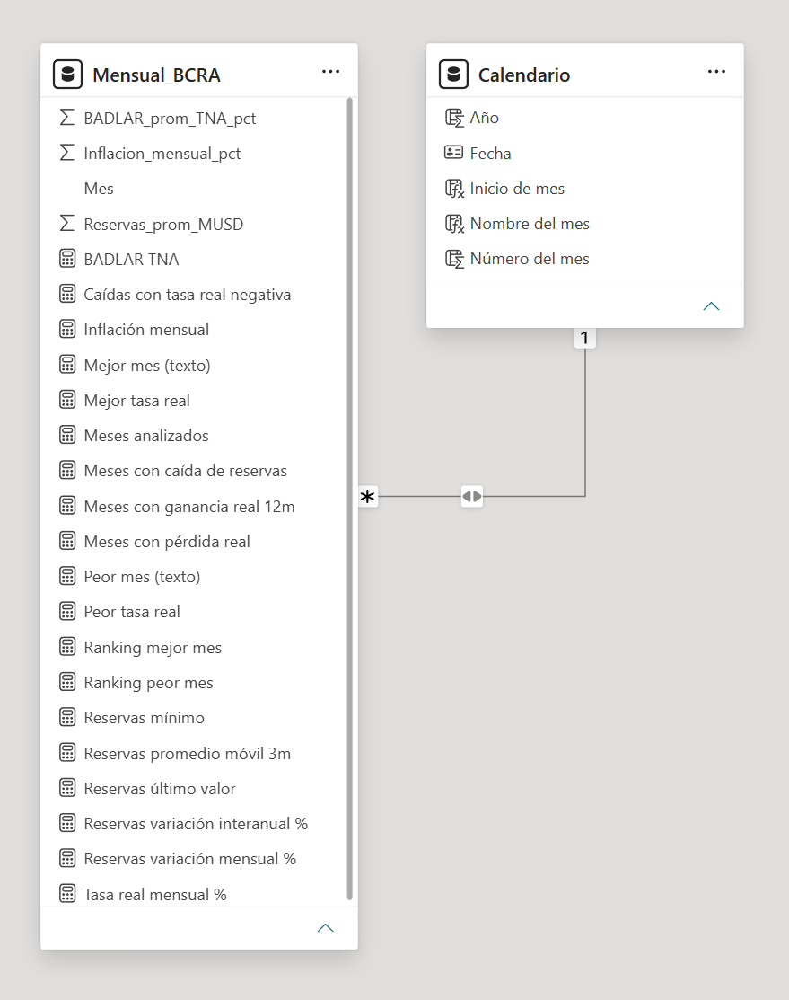

# Tablero del sistema financiero argentino (Power BI + SQL + DAX)

## 1. Pregunta de negocio

Un analista de una entidad financiera necesita decidir si ofrecer plazos fijos en pesos es atractivo para los ahorristas, y para eso tiene que saber si la tasa real fue positiva o negativa en los últimos meses y cómo evolucionaron las reservas.

### Preguntas que responde 

1. 	¿En cuántos de los últimos 12 meses la tasa real fue positiva?
2. 	¿Cuál fue el peor y el mejor mes para quien colocó a tasa BADLAR en los últimos 5 años?
3. ¿Cómo evolucionó el nivel de reservas y en qué períodos cayó más?
4. 	¿Los meses de tasa real negativa coinciden con caídas de reservas?

## 2. Datos

| Variable | idVariable | Periodicidad | Unidad | Moneda | Desde | Hasta |
| --- | --- | --- | --- | --- | --- | --- |
| Reservas internacionales | 1 | D | Millones de USD | ME | 2021-10-01 | 2026-10-02 |    
| Tasa de interés BADLAR de bancos privados | 7 | D | % Nominal Anual | ML | 2021-10-01 | 2026-10-05 |
| Inflación mensual| 27 | M | % | ML | 2021-10-01 | 2026-08-31 |

- **Fuente:** API de Estadísticas Monetarias v4.0 del BCRA (https://www.bcra.gob.ar/apis-banco-central/).
- **Fecha de descarga:** 2026-10-06
- **Cómo se descargaron:** JSON bajado desde el navegador
- **Limitaciones de los datos:**
  - Las series de reservas y BADLAR son diarias y la inflación es mensual: llevé las dos primeras a promedio mensual. Para las reservas la alternativa era el último valor del mes.
  - El período común termina en agosto de 2026, cuando termina la inflación: 59 meses (octubre 2021 a agosto 2026), sin faltantes.
  - BADLAR es la tasa de depósitos grandes. El plazo fijo minorista suele pagar menos, así que su tasa real sería peor que la calculada.

## 3. Modelo de datos

Dos tablas: `Mensual_BCRA` (una fila por mes, con reservas, BADLAR e inflación) y `Calendario` (tabla de fechas creada con DAX, de octubre 2021 a agosto 2026). Relación de uno a muchos de `Calendario` a `Mensual_BCRA`, para que los gráficos y las medidas de tiempo usen un mismo calendario.

Las tres series de la API (reservas, BADLAR e inflación) se consolidaron en una sola tabla mensual antes de modelar: BADLAR y reservas son diarias y se promediaron por mes para igualar la periodicidad de la inflación. Todas las medidas DAX viven en `Mensual_BCRA`. La relación une `Mes` con `Fecha` y filtra en ambas direcciones.

Nota sobre el cruce de la pregunta 4: la tasa real fue negativa en 41 de 59 meses, pero el primer mes (oct 2021) no tiene variación de reservas, así que en ese cruce los meses son 58 (40 con tasa real negativa).

## 4. Consultas SQL

Están en [`sql/consultas.sql`](sql/consultas.sql). Resumen:

| # | Qué calcula | Técnica |
| --- | --- | --- |
| 1 | Variación mensual | LAG |
| 2 | Promedio móvil | Función de ventana |
| 3 | Ranking de meses con mayor variación | ORDER BY / RANK |
| 4 | Tasa real | CTE |
| 5 | Cobertura de datos | Agregaciones |
| 6 | Caídas de reservas con tasa real negativa | CTE + CASE WHEN |
| 7 | Las 5 mayores caídas de reservas y su tasa real | CTE + ORDER BY |

## 5. Medidas DAX

| Medida | Qué hace (una línea) | Validada contra SQL |
| --- | --- | --- |
| Reservas último valor | Reservas del último mes del período seleccionado | Sí (mínimo y máximo, consulta 2) |
| Reservas variación mensual % | Cambio porcentual contra el mes anterior (DATEADD -1 mes) | Sí (consulta 1) |
| Reservas variación interanual % | Cambio porcentual contra el mismo mes del año anterior | No (sin consulta equivalente) |
| Reservas promedio móvil 3m | Promedio de los últimos 3 meses | Sí (consulta 2) |
| Tasa real mensual % | (1 + TEM) / (1 + inflación) − 1, con TEM = TNA × 30/365 | Sí (consulta 4) |
| Meses con ganancia real 12m | Cuenta meses con tasa real positiva en los últimos 12 | Sí (4 de 12, consulta 4) |
| Peor / Mejor tasa real | Mínimo y máximo de la tasa real mensual en todo el período | Sí (consulta 4) |
| Meses con pérdida real | Cuenta meses con tasa real negativa (41 de 59) | Sí (consulta 4) |
| Meses con caída de reservas | Cuenta meses con variación negativa (28) | Sí (consulta 1) |
| Caídas con tasa real negativa | Meses con caída de reservas y tasa real negativa (20) | Sí (consulta 6) |
| Ranking peor / mejor mes | Posición de cada mes por tasa real, para los rankings de 5 | Sí (consulta 4) |

## 6. El tablero

- Página 1, Resumen ejecutivo (pregunta 1): `capturas/pagina1.png`
- Página 2, Tasa real en detalle (pregunta 2): `capturas/pagina2.png`
- Página 3, Reservas y tasa real (preguntas 3 y 4): `capturas/pagina3.png`

## 7. Hallazgos

Solo conclusiones que se puedan comprobar con una consulta de `consultas.sql`.

1. En los últimos 12 meses (sep 2025 a ago 2026) la tasa real fue positiva en solo 4 (sep, oct y nov 2025 y ago 2026). Consulta 4.
2. En 59 meses, la tasa real fue negativa en 41. El peor mes fue diciembre de 2023 (−12,38 %, con BADLAR de 121 % anual e inflación mensual de 25,5 %) y el mejor, agosto de 2025 (+2,01 %). Consulta 4.
3. Las reservas tocaron su mínimo en noviembre de 2023 (21.399 MUSD) y su máximo en agosto de 2026 (49.859 MUSD); bajaron en 28 meses y subieron en 30. Consultas 1 y 2.
4. No hay coincidencia sistemática entre tasa real negativa y caídas de reservas: de 28 meses con caída, 20 (71 %) tuvieron tasa real negativa, y esa condición se da en el 69 % de todos los meses. (Consulta 6.) Cuatro de las cinco mayores caídas son de 2023 y dos ocurrieron con tasa real positiva (consulta 7).

Limitación: son 58 meses y 3 variables; sirve para descartar un patrón simple, no para probar causas.

## 8. Uso de IA generativa

Ver [`ia/registro-claude.md`](ia/registro-claude.md): qué pedí, qué devolvió y qué corregí.

Resumen: las preguntas, la elección de variables, las consultas SQL y las medidas DAX de la página 1 las desarrollé yo, con pistas de Claude y validando cada medida contra SQL. Las páginas 2 y 3 y las medidas adicionales las armó Claude con el plugin de Power BI Authoring, a partir de un diseño acordado; yo revisé los resultados contra mis consultas y corregí formato y presentación. Yo decidí qué conclusiones se pueden afirmar y cuáles no. Lo que aprendí es que la IA acelera la construcción, pero el criterio sobre qué mide el tablero y qué se puede concluir sigue siendo mío.

## 9. Cómo reproducirlo

1. Clonar el repositorio.
2. Abrir `tablero.pbip` (o `tablero.pbix`) en Power BI Desktop (solo Windows).
3. Para actualizar los datos: Inicio → Actualizar. Las series se leen de la API pública del BCRA con acceso anónimo.

## Autor

Gonzalo Ducca, científico de datos, enfocado en BI financiero. [LinkedIn](https://www.linkedin.com/in/gonzalo-ducca-b079011b2/)
